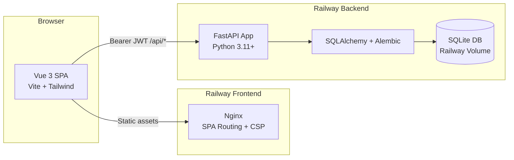

# OnboardPilot

[](https://onboardpilot-frontend-production.up.railway.app)
[](https://opensource.org/licenses/MIT)
[](https://www.python.org/)
[](https://vuejs.org/)
[](https://fastapi.tiangolo.com/)
[](https://www.sqlite.org/)
[](https://github.com/siliconsagenerd/onboardpilot)

[Deutsch](#deutsch) | [English](#english)

---

## Deutsch

### Übersicht

OnboardPilot ist eine leichtgewichtige IT-Onboarding-Konsole für IT-Support, Teamleiter und neue Mitarbeitende. Ein Onboarding-Fall pro Starter bündelt Checklisten-Abhängigkeiten, Hardware-Ausgabe, Berechtigungsanträge, offene Nacharbeiten und ein druckbares Übergabeprotokoll.

Demo-Projekt mit synthetischen Daten. Keine Anbindung an echtes Active Directory, kein LDAP, kein echter Mailversand.

**Live:** [onboardpilot-frontend-production.up.railway.app](https://onboardpilot-frontend-production.up.railway.app)

### Demo-Zugangsdaten

| Rolle | Benutzername | Passwort | Zweck |
|---|---|---|---|
| IT-Admin | `admin` | `Admin123!` | Vollzugriff, Fälle anlegen, Hardware ausgeben, Freigaben prüfen |
| Abteilungsleitung | `manager` | `Manager123!` | Fälle der Abteilung einsehen, Anträge anfordern, Fortschritt verfolgen |
| Neue/r Mitarbeiter/in | `employee` | `Employee123!` | Eigene Checkliste, zugewiesene Geräte, Onboarding-Leitfäden einsehen |

Öffentliche Demo ohne Login verfügbar unter: [onboardpilot-frontend-production.up.railway.app/public-demo](https://onboardpilot-frontend-production.up.railway.app/public-demo) (Fall Anna Beispiel).

### Was das Projekt abdeckt

| Anforderung | Umsetzung in OnboardPilot |
|---|---|
| Hardware-Ausgabe | Erfassung von Seriennummer, Modell, Zustand und automatische Verknüpfung mit dem Checklisten-Schritt |
| Benutzer- und Rechtekontrolle | Zustandsautomat für Zugriffsanträge (`requested` -> `approved` -> `provisioned` -> `verified`) |
| Checklisten-Ablauf | Abhängigkeitslogik: Nachfolgende Schritte bleiben gesperrt, bis Vorgänger erledigt sind |
| Übergabedokumentation | Generierung eines PDF-Übergabeprotokolls mit FPDF2 zur Unterschrift vor Ort |
| Offene Punkte & Klärungsbedarf | Nachverfolgung offener Aufgaben mit Prioritäten, Fristen und Fälligkeitserkennung |
| IT-Wissensbasis | Zweisprachige Onboarding-Leitfäden (DE/EN) mit Volltextsuche |
| Nachvollziehbarkeit | Revisionssicherer Audit-Trail für jede Statusänderung |

### Architektur



### Projektstruktur

```
onboardpilot/
├── alembic/                # Datenbank-Migrationen
├── docs/                   # API- und Deployment-Spezifikationen
│   ├── api.md              # REST-Endpunkte und Parameter
│   └── deployment.md       # Railway Zwei-Dienste-Architektur
├── frontend/               # Vue 3 SPA
│   ├── src/
│   │   ├── i18n/           # Zweisprachige UI-Übersetzungen (DE/EN)
│   │   ├── stores/         # Pinia Auth Store & Session Management
│   │   ├── views/          # Dashboard, Fallübersicht, Detailansicht, Leitfäden
│   │   └── style.css       # Design-Tokens, Typografie und Dark-Mode
│   └── nginx.conf          # Nginx-Konfiguration mit Sicherheits-Headern
├── src/onboardpilot/       # FastAPI Backend
│   ├── auth.py             # JWT-Token, Kennwort-Hashing (bcrypt)
│   ├── db/                 # SQLAlchemy Modelle und Datenbank-Engine
│   ├── routers/            # Modulare API-Routen (cases, hardware, access, audit, guides)
│   └── services/           # Initialer Datenseed (Demo-Fälle und Standardleitfäden)
└── tests/                  # Pytest Testsuite (20 Tests)
```

### Schnellstart (Lokal)

Voraussetzungen: Python 3.11+, Node.js 20+.

1. Backend starten:
```bash
python3 -m venv .venv
source .venv/bin/activate
pip install -e ".[dev]"
PYTHONPATH=src alembic upgrade head
PYTHONPATH=src python3 -m onboardpilot.services.seed
PYTHONPATH=src uvicorn onboardpilot.main:app --reload --port 8000
```

2. Frontend starten:
```bash
cd frontend
npm install
npm run dev
```

3. Mit Docker Compose (kompletter Stack):
```bash
docker compose up --build
```
Backend läuft unter `http://localhost:8000`, Frontend unter `http://localhost:5173`.

### Konfiguration

| Variable | Standardwert | Zweck |
|---|---|---|
| `DATABASE_URL` | `sqlite:///./onboardpilot.db` | Pfad zur SQLite-Datenbankdatei |
| `JWT_SECRET` | `change-me-in-production` | Geheimer Schlüssel zur Signierung der JWT-Tokens |
| `JWT_EXPIRE_MINUTES` | `480` | Gültigkeitsdauer der Authentifizierungstokens |
| `VITE_API_BASE_URL` | `https://sublime-vibrancy-production-3a42.up.railway.app` | Backend-URL für das Frontend |

### Tests

```bash
# Backend-Tests ausführen
pytest -q --disable-warnings
```
Ergebnis: 20 bestandene Tests (Authentifizierung, Fallstatus, Hardware-Logik, Zugriffsautomat, Audit-Trail).

### Bekannte Limitationen

- Synthetische Demo-Daten; keine Verbindung zu echtem Microsoft 365, Azure AD oder Google Workspace.
- Kein automatisierter E-Mail- oder SMS-Versand implementiert (im Prototyp bewusst deaktiviert).
- Single-Node-SQLite über Railway Persistent Volume (ausreichend für Demo-Betrieb, für Produktionsbetrieb PostgreSQL empfohlen).
- E2E-Browser-Tests laufen lokal via Agent-Browser / Playwright, keine CI-integrierte Matrix.

### Dokumentation

- [docs/api.md](docs/api.md): Detaillierte REST-API-Dokumentation.
- [docs/deployment.md](docs/deployment.md): Deployment-Ablauf, Umgebungsvariablen und Wiederherstellung.

### Deployment-Status

Produktiv auf Railway (Zwei-Dienste-Verbund):
- Frontend: `https://onboardpilot-frontend-production.up.railway.app`
- Backend API: `https://sublime-vibrancy-production-3a42.up.railway.app`

### Lizenz

MIT License.

---

## English

### Overview

OnboardPilot is a lightweight IT onboarding orchestration console for IT support teams, managers, and new hires. It organizes each new starter into a structured case tracking checklist dependencies, hardware provisioning, access permissions, open follow-up items, and printable handover protocols.

Demo project built with synthetic data. No connection to real Active Directory, LDAP, or corporate mail servers.

**Live:** [onboardpilot-frontend-production.up.railway.app](https://onboardpilot-frontend-production.up.railway.app)

### Demo Credentials

| Role | Username | Password | Purpose |
|---|---|---|---|
| IT Admin | `admin` | `Admin123!` | Full permissions: create cases, assign hardware, verify access |
| Manager | `manager` | `Manager123!` | Department view: request access, review onboarding progress |
| Employee | `employee` | `Employee123!` | Personal view: assigned checklist, hardware list, IT guides |

Public read-only demo without login: [onboardpilot-frontend-production.up.railway.app/public-demo](https://onboardpilot-frontend-production.up.railway.app/public-demo) (Anna Beispiel case).

### Features

| Focus Area | Capability |
|---|---|
| Hardware Provisioning | Serial number tracking, device conditions, automatic checklist item completion |
| Access Control | 4-step state machine (`requested` -> `approved` -> `provisioned` -> `verified`) |
| Structured Checklists | Dependency enforcement: downstream items remain locked until prerequisites pass |
| Handover Documentation | On-the-fly PDF handover protocol generation with FPDF2 for physical signature |
| Open Follow-ups | Track pending blockers, assign owners, set priorities and monitor due dates |
| IT Knowledge Base | Bilingual guides (DE/EN) with client-side instant search |
| Compliance & Audit | Append-only audit trail logging every state transition |

### Quick Start (Local)

Prerequisites: Python 3.11+, Node.js 20+.

1. Run Backend:
```bash
python3 -m venv .venv
source .venv/bin/activate
pip install -e ".[dev]"
PYTHONPATH=src alembic upgrade head
PYTHONPATH=src python3 -m onboardpilot.services.seed
PYTHONPATH=src uvicorn onboardpilot.main:app --reload --port 8000
```

2. Run Frontend:
```bash
cd frontend
npm install
npm run dev
```

### Known Limitations

- Synthetic sample data; no active integration with corporate Active Directory or Google Workspace.
- Outbound emails and notifications are mocked for demo safety.
- Single-instance SQLite backend hosted on a Railway persistent volume.

### Documentation & Deployment

- [docs/api.md](docs/api.md): Full endpoint reference.
- [docs/deployment.md](docs/deployment.md): Architecture and rollback guide.
- Live Deployment: Railway (`onboardpilot-frontend-production.up.railway.app` + `sublime-vibrancy-production-3a42.up.railway.app`).

### License

MIT License.
